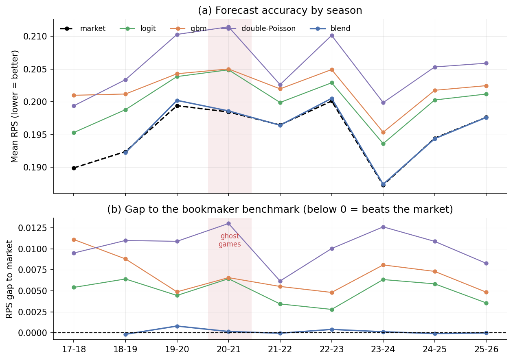

# Football forecasting against the betting market

**Can models built from public match records improve on bookmaker probabilities?**
This study compares four statistical and machine-learning models with Bet365
odds across the five major European leagues. It combines chronological feature
engineering, expanding-season evaluation, proper scoring rules, calibration
analysis, and retrospective betting diagnostics.

**Result:** the market outperforms all four standalone models in RPS in each of
nine test seasons. The tested model-market blend is slightly worse than the
market on the same matches and shows no statistically significant improvement in
any season, and all 16 model/threshold betting configurations have negative
realized returns. A negative result is useful here: a strong external
benchmark makes it harder to mistake model complexity for predictive value.

## Main findings

| Result | Saved estimate |
|---|---|
| Data coverage | 21,583 matches, 2014–15 to 2025–26; 16,106 test matches |
| Market RPS | **0.19511**; lower is better |
| Best standalone model: full-feature logit | 0.20007; gap +0.00496, date-clustered t = 12.5 |
| Gradient boosting | 0.20200; worse than the logit in the pooled comparison |
| GBM-market blend | 0.19593 versus market 0.19578 on the **same 14,280 matches**; gap +0.00015 (blend worse), unadjusted p = 0.047 |
| Market home-win bias (realized − implied) | −2.56 pp in 2020–21; −2.64 pp in 2024–25, with pointwise 95% intervals excluding zero (Shin de-margining); about −2.2 pp in both seasons with proportional normalization |
| Betting ROI across 16 model/threshold configurations | **−13.8% to −4.1%**; some confidence intervals include zero |
| GBM taken-to-closing-odds movement | +0.79% on 10,803 selected bets (θ = 0.05, from 2019–20, where closing odds exist); this is a price ratio, not expected profit |

The blend has small favorable point estimates in four seasons, but none is
statistically significant; its deficits in 2019–20 and 2022–23 are nominally
significant (unadjusted p = 0.013 and 0.024). The market-bias estimates depend
partly on the de-margining method: Shin's method gives the usually favoured home
side about 0.4 percentage points more probability than proportional
normalization, which the home-advantage study uses, and the pre-pandemic test
seasons already show Shin biases of −0.3 to −0.5 pp. `t5_market_bias_by_season.csv`
reports both versions. These findings concern the tested features and models;
they do not prove that all public information is already priced or that every
possible betting strategy is unprofitable.



## Method

- **Features:** sequential Elo, rolling points, goals, shots on target and
  corners, venue form, rest days, season progress, and league indicators.
  Features use prior matches, including the six without complete Bet365 prices;
  odds enter the benchmark and blend, but not the four standalone models.
- **Models:** Elo-only multinomial logit, full-feature regularized logit,
  histogram gradient boosting, and a time-decayed independent Poisson goal model.
- **Validation:** train on earlier seasons and test on the next season, from
  2017–18 through 2025–26. Model parameters update annually; team features update
  after matches. The blend uses only previous seasons' out-of-sample forecasts.
- **Evaluation:** RPS, log-loss, Brier score, accuracy, calibration, date-clustered
  score-difference tests, and date-clustered bootstrap intervals for betting ROI.

## Read the work

- [Machine-readable results](output/results.json): reported metrics and backtest grid.
- [Tables](output/tables/) and [figures](output/figures/). In
  `t3_rps_by_period.csv`, the `market_blend_sample` row restricts the market to
  the blend's matches, the like-for-like comparison for the blend row.
- [Companion home-advantage study](../home-advantage/README.md).

## Reproduce

Use the Python environment and pinned dependencies in the
[repository setup](../README.md). Obtain the shared raw match files using
[the data-source instructions](../DATA_SOURCES.md). Raw and per-match derived
files are excluded from this public package.

From the repository root, run these scripts **in order**:

```bash
python forecasting/src/01_features.py
python forecasting/src/02_models.py
python forecasting/src/03_evaluate.py
python forecasting/src/04_backtest.py
python forecasting/src/05_figures.py
```

The feature script reads the 60 required league-season CSVs from
`home-advantage/data/raw/`; unrelated extra CSVs are ignored.
It writes `data/features.csv`; the next scripts create `data/predictions.csv`,
`data/predictions_scored.csv`, result tables/JSON, and five figures. Paths resolve
relative to the scripts, so execution does not depend on the current directory.
Run evaluation before backtesting: evaluation creates `results.json`, and
backtesting adds the `backtest` section that the final figure script needs.

## Limits worth knowing

Historical non-closing odds snapshots do not have synchronized quote timestamps.
A quote may precede a prior match used in the feature history, so the betting
results are retrospective diagnostics, not a demonstrated executable strategy.
The pipeline assumes quoted prices and stakes are available.

Hyperparameters are fixed in the released code; GBM early stopping uses a random
split inside the historical training data. Model refits are annual, the Poisson
model omits low-score dependence, and player-level information is excluded.
Date clustering handles same-day dependence but not serial dependence, and
seasonal confidence intervals and p-values are unadjusted for multiple comparisons.
The blend starts one season later, so its calibration plots and betting results use
a different sample. Elo starts newly observed teams at 1,400; this includes the
initial sample teams. A club returning to a league after at least one season away
also restarts at 1,400, with its rolling form cleared. Figure 4's error bars are
standard deviations over five permutation shuffles, not confidence intervals.
