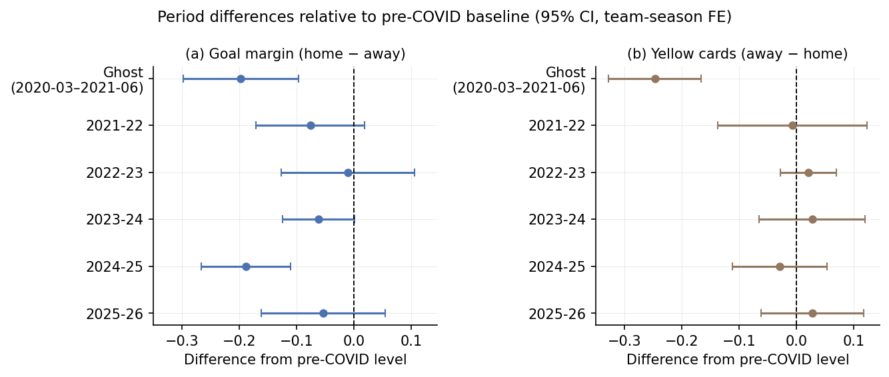

# Home advantage during and after closed-stadium football

**Chung Shing Mars Wong** · European football, 2014–15 to 2025–26

A research project using **21,589 matches across five European leagues** to examine how home advantage and disciplinary outcomes differed during COVID-19 stadium restrictions and the five seasons afterward. The analysis combines team-season fixed effects, clustered inference, a wild-cluster bootstrap, and sensitivity checks.

## Results

| Adjusted comparison with the pre-pandemic period | Estimate |
|---|---:|
| Baseline home goal-margin advantage | +0.361 goals |
| Closed-stadium-period goal-margin difference | **−0.198 goals**; 95% CI −0.298 to −0.097 |
| Closed-stadium-period home-win difference | **−5.1 percentage points** |
| Closed-stadium-period yellow-card difference, away minus home | **−0.247 cards**, from a +0.263 baseline |
| 2024–25 goal-margin difference | **−0.189 goals** |
| 2025–26 goal-margin difference | −0.054 goals; 95% CI −0.162 to +0.055 |

The goal-margin reduction in the closed-stadium period was approximately 55% of the baseline. Post-period yellow-card point estimates stayed within ±0.03 of baseline, while goal-margin estimates varied more by season. The 2025–26 estimate is not statistically distinguishable from baseline; this does not prove exact recovery. Likewise, a test failing to distinguish 2024–25 from the ghost period does not establish equivalence.



## Method and limits

Each match outcome is regressed on an intercept and period indicators, with a team-season strength entering +1 for the home team and −1 for the away team. Sparse least squares partials out 1,170 team-season categories (1,110 independent strength parameters). Pooled standard errors use 60 league-season clusters. The analysis also reports a null-imposed wild-cluster bootstrap, a within-2019–20 comparison, a pre-period placebo, a narrower-window sensitivity check, and league-level estimates. The within-2019–20 and league-level specifications have too few league-season clusters, so they cluster by league matchday (league × calendar date).

These are **adjusted period comparisons**. Stadium restrictions coincided with schedule, rule, and health changes, so an isolated causal crowd effect requires additional assumptions. Cards and fouls reflect both player conduct and referee decisions. Attendance is approximated by policy windows, including some partially open matches; the `ghost_strict` variable is a narrower-window sensitivity definition, not verified match-level zero attendance. The five-season volatility comparison is descriptive.

The closed-stadium indicator is nonzero in only 10 of the 60 league-season clusters, and each single post-pandemic season indicator in only 5 (the pooled post indicator covers 25). In simulations with this design ([`tests/simulate_coverage.py`](../tests/simulate_coverage.py)), the analytic 95% intervals covered the true value about 92% of the time for the closed-stadium coefficient and 85–95% for single post-pandemic seasons. The null-imposed wild-cluster bootstrap p-values in `results.json` (`pooled_wild`) are the more reliable guide: 0.003 for the closed-period goal margin, 0.001 for 2024–25 (the smallest value 999 bootstrap draws can give) and 0.467 for 2025–26. Matchday clustering in the league-level and within-2019–20 specifications allows for common shocks within a league on a date, but not for club-specific home advantage persisting through a season; in the same simulations its intervals covered 93–97% with independent errors and 88–97% with club-specific home advantage.

Bookmaker probabilities use the provider's Bet365 `B365H/D/A` snapshots, normalized proportionally for overround. They do not use the separate `B365CH/CD/CA` closing fields and do not establish betting profitability or market inefficiency. The forecasting study de-margins the same prices with Shin's method, which gives the home side about 0.4 percentage points more probability, so its implied home-win rates are slightly higher than the ones here.

## Explore the work

- [Tables](output/tables/) and [figures](output/figures/): saved research outputs.
- [Machine-readable estimates](output/results.json): coefficients, uncertainty, contrasts, sample counts, and bootstrap p-values.
- [Source scripts](src/): data preparation, estimation, and figure generation.

## Reproduce

From the published repository root, install the shared Python dependencies and enter this project:

```bash
python3 -m pip install -r requirements.txt
cd home-advantage
```

Raw data are not redistributed. Read [data access and source terms](../DATA_SOURCES.md), then place the 60 league-season files in `data/raw/` using names such as `E0_1415.csv`. The historical downloader is an explicit acquisition helper for permitted use; run `bash src/01_download.sh` only after reviewing the provider's current terms. It skips existing files and stops if a download fails.

Once the raw files are present:

```bash
python3 src/02_clean.py      # creates data/processed/matches.csv
python3 src/03_analysis.py   # estimates, bootstrap, tables, output/results.json
python3 src/04_figures.py    # output/figures/*.png
```

Paths inside the Python scripts are resolved relative to the project. The cleaner requires all 60 expected inputs rather than silently analyzing a partial download. The estimation step includes 999 bootstrap replications per tested coefficient and takes longer than cleaning or plotting.

`table4_s1920.csv` reports the within-2019–20 comparison with league-matchday clustering, from `s1920` in `results.json`. Earlier releases clustered on home and away team-season. Those groups coincide with the absorbed team-season strengths, so their clustered variance largely cancels and understates uncertainty; see [the validation record](../docs/VALIDATION.md).
